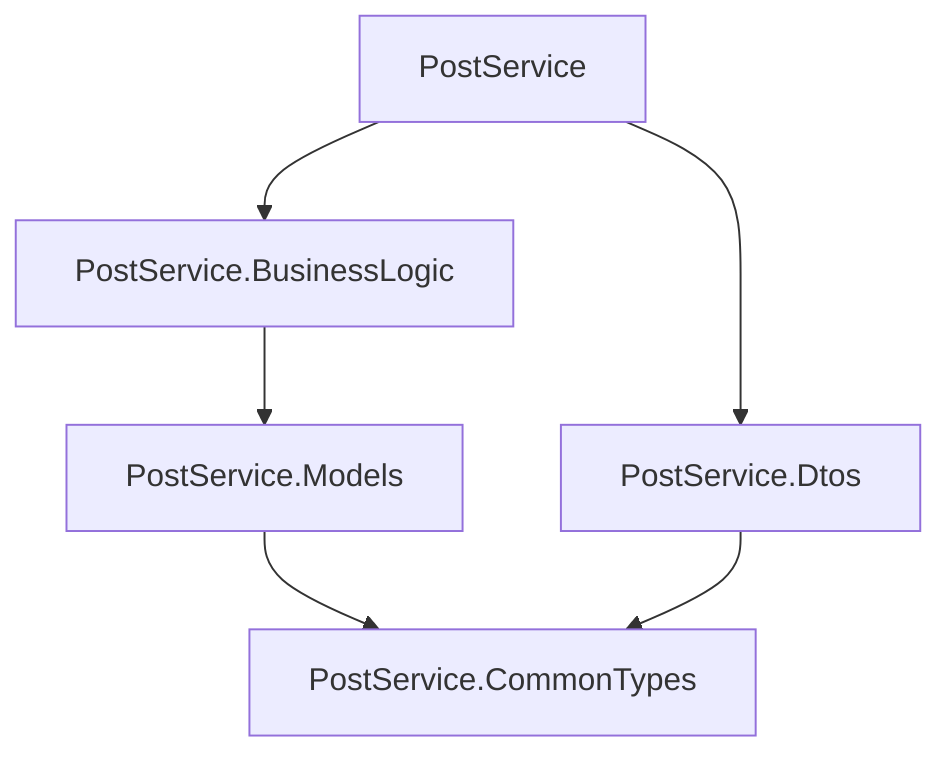

# ПР-40. Розділення застосунку на компоненти

PostService перенесено в рішення з п’яти проєктів .NET 10. HTTP-контракт і бізнес-правила попередньої практичної збережено.

| Проєкт | Вміст |
|---|---|
| PostService.CommonTypes | Спільний перелік `DeliveryType` |
| PostService.Models | Модель `Posting` |
| PostService.Dtos | DTO створення, редагування та відповіді |
| PostService.BusinessLogic | `IPostingService`, `PostingService`, бізнес-виняток |
| PostService | Minimal API, мапер, HTTP middleware, конфігурація |



Стрілка означає посилання споживача на залежність. Консольний проєкт `Checks` розміщений окремо й не входить у основне рішення: він демонструє повторне використання бібліотек без веб-застосунку.

## Запуск

Потрібен .NET SDK 10. Команди з кореня репозиторію:

```powershell
cd PostServiceSolution
dotnet build PostService.slnx
dotnet run --project PostService/PostService.csproj
```

Адреса API: `http://localhost:5050`. Дані зберігаються в пам’яті процесу й очищаються після його перезапуску.

| Метод | Шлях | Результат |
|---|---|---|
| GET | `/` | Текст привітання |
| GET | `/postings` | Перелік відправлень, 200 |
| GET | `/postings/{id}` | Відправлення, 200 або 404 |
| POST | `/postings` | Створення, 201 і Location; валідація — 400 |
| PUT | `/postings/{id}` | Оновлення, 200; помилка — 400 або 404 |
| DELETE | `/postings/{id}` | Видалення, 204 або 404 |

## Перевірки

Без запущеного API, з кореня репозиторію:

```powershell
dotnet run --project Checks/ComponentChecks.csproj
```

З працюючим API в іншому терміналі:

```powershell
dotnet run --project Checks/ComponentChecks.csproj -- --base-url http://localhost:5050/
```

Виконано 16/16 перевірок: 8 перевірок бібліотеки й 8 груп HTTP-перевірок. Кожен із п’яти проєктів і все рішення зібрано окремо без помилок та попереджень. Фактичні результати містяться в [reports](reports/).

## VS Code та REST Client

Відкрити саме папку `PostServiceSolution`, де міститься `.vscode`. Розширення C#, REST Client і Solution Explorer встановлені; їхні версії записані в `reports/extensions.txt`. Якщо редактор показує Restricted Mode, користувач має сам перевірити файли й підтвердити довіру до цієї папки.

1. У Solution Explorer відкрити `PostService.slnx` і переглянути п’ять проєктів.
2. Зупинити звичайний запуск API, щоб звільнити порт 5050.
3. У `PostService.BusinessLogic/PostingService.cs` поставити точку зупину на виклику `Validate` в методі `Create`.
4. Обрати конфігурацію `PostService (build and debug)` та натиснути F5. Є також конфігурація запуску вже зібраного проєкту.
5. Відкрити `requests.http`, натиснути **Send Request** біля першого POST, перевірити зупинку в бібліотеці, продовжити F5.
6. Виконати решту запитів: отримання, оновлення, перевірка помилки, видалення та 404 після видалення. Запити використовують ідентифікатор першої відповіді через іменований запит REST Client.

**Статус ручної перевірки:** у доступному редакторі залишається Restricted Mode. Фактична зупинка на breakpoint, подання Solution Explorer і виконання запитів кнопкою Send Request ще не підтверджені. Файли конфігурації та DLL/PDB підготовлені; API перевірено окремими автоматизованими HTTP-запитами.

Тарифи залишені з ПР-39 як навчальне припущення: відділення `40 + 10 × вага`, кур’єр `80 + 15 × вага`, експрес `120 + 24 × вага`. Для 2 кг це 60/110/168. POST обчислює ціну, Id і час на сервері; PUT зберігає явне редагування ціни. Нових тарифів ця практична не задає.

Повний [звіт із поясненнями та відповідями на контрольні запитання](reports/REPORT.md).
