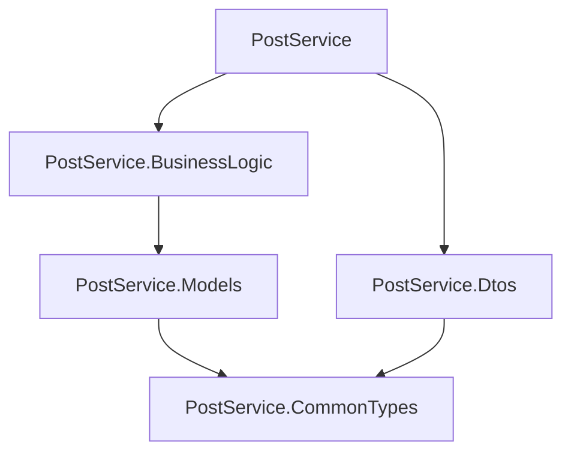

# Звіт. ПР-40 «Розділення застосунку на компоненти»

## Мета та виконана робота

Застосунок попередньої практичної розділено на бібліотеки спільних типів, моделей, DTO і бізнес-логіки та веб-проєкт. Створено `PostServiceSolution/PostService.slnx` і чотири бібліотеки через CLI; шаблонні `Class1.cs` видалено. Простір імен `PostService.Services` замінено на `PostService.BusinessLogic`, оновлено `using`. Мапер і HTTP-обробник бізнес-помилок залишені у веб-проєкті.

## Схема залежностей



Усі стрілки — прямі `ProjectReference` від споживача до залежності.

| Пряме посилання | Конкретні типи, які його потребують |
|---|---|
| Models → CommonTypes | Властивість `Posting.DeliveryType` має тип `DeliveryType`. |
| Dtos → CommonTypes | `PostingPostDto`, `PostingPutDto`, `PostingGetDto` містять `DeliveryType`. |
| BusinessLogic → Models | Методи `IPostingService` і `PostingService` приймають або повертають `Posting`; внутрішнє сховище — `List<Posting>`. |
| PostService → BusinessLogic | DI реєструє `IPostingService`/`PostingService`, ендпойнти викликають інтерфейс; middleware обробляє `PostingValidationException`. |
| PostService → Dtos | Ендпойнти й мапер використовують `PostingPostDto`, `PostingPutDto`, `PostingGetDto`. |

`BusinessLogic` бачить `DeliveryType` транзитивно через `Models`. Веб-проєкт бачить `Posting` через `BusinessLogic → Models`, а `DeliveryType` через обидві гілки. Додаткових прямих посилань для цих типів у цій конфігурації не потрібно. CommonTypes не посилається на інші проєкти, циклів немає.

## Складання та перевірка поведінки

Команди виконувалися з `PostServiceSolution`:

```powershell
dotnet build PostService.CommonTypes/PostService.CommonTypes.csproj
dotnet build PostService.Models/PostService.Models.csproj
dotnet build PostService.Dtos/PostService.Dtos.csproj
dotnet build PostService.BusinessLogic/PostService.BusinessLogic.csproj
dotnet build PostService/PostService.csproj
dotnet build PostService.slnx
dotnet sln PostService.slnx list
dotnet run --project PostService/PostService.csproj --no-build
```

Усі шість складань успішні, без помилок і попереджень. Повний вивід — [build-results.txt](build-results.txt); склад рішення й прямі посилання — [solution-and-references.txt](solution-and-references.txt).

Консольний `Checks` використовує ті самі бібліотеки. Для запуску з кореня рішення:

```powershell
dotnet run --project ../Checks/ComponentChecks.csproj
dotnet run --project ../Checks/ComponentChecks.csproj -- --base-url http://localhost:5050/
```

Друга команда потребує окремо запущеного API. Перевірено 16 груп сценаріїв, усі пройшли: тарифи, дробова вага, призначення Id/CreatedAt/Price, видалення та повторне створення, оновлення, відсутні записи, валідація, захист сховища від зовнішніх змін; через HTTP — створення 201, Location, усі види доставки, збереження між запитами, GET, PUT, DELETE 204, помилки 400 і 404. Фактичний вивід — [checks-output.txt](checks-output.txt). Для двокілограмових відправлень ціни залишилися 60/110/168, як у попередній роботі. Зберігання в пам’яті та старі навчальні тарифи збережені.

Консольний проєкт не посилається на веб-проєкт і використовує runtime `Microsoft.NETCore.App` без `Microsoft.AspNetCore.App`: [console-runtime.txt](console-runtime.txt). Це практична демонстрація повторного використання бізнес-логіки в іншому типі застосунку.

## Редактор і відлагодження

Установлені Solution Explorer 0.9.8, REST Client 0.25.1 і C# 2.160.4: [extensions.txt](extensions.txt). У корені рішення додано `.vscode/tasks.json` із задачею складання всього `PostService.slnx`; `launch.json` запускає DLL веб-проєкту з його робочої папки й використовує цю задачу. Є окрема конфігурація для вже зібраного коду.

Для кожного проєкту підтверджена наявність Debug DLL і PDB: [debug-artifacts.txt](debug-artifacts.txt). PDB пов’язують вихідні рядки з виконуваним кодом, що дозволяє поставити breakpoint у бібліотеці.

**Непідтверджена ручна частина:** під час перевірки VS Code показував Restricted Mode для папки рішення. Довіру до папки має підтвердити користувач після перевірки коду. Зупинку в `PostingService.Create`, відображення дерева Solution Explorer та виконання запитів через UI REST Client не зафіксовано. Наявність PDB і проходження автоматизованих HTTP-перевірок не видається за таку ручну перевірку. Послідовність її виконання наведено в README, запити підготовлені в `requests.http`.

## Переваги поділу й повторне використання

Веб-проєкт відповідає за HTTP і перетворення DTO, бізнес-бібліотека — за операції над відправленнями та правила. Зміна HTTP-маршрутів не вимагає перенесення бізнес-коду. DTO не залежать від внутрішньої моделі: обидві бібліотеки використовують лише спільний перелік. Бібліотеки можна збирати й перевіряти окремо.

Другий консольний або настільний застосунок може використати `DeliveryType`, `Posting`, `IPostingService`, `PostingService` і бізнес-виняток без зміни їхнього коду. DTO можна повторно використати для такого самого контракту обміну. HTTP-маршрути й middleware належать веб-рівню. Наявне сховище статичне лише всередині одного процесу: різні запущені застосунки не матимуть спільної бази даних автоматично.

## Контрольні запитання

1. **Class Library і веб-застосунок.** Бібліотека надає типи та методи для іншого коду, не має власної точки входу. Веб-застосунок запускає процес і HTTP-сервер. Саму бібліотеку через `dotnet run` не запускають.
2. **Рішення.** Файл `.slnx` об’єднує проєкти й описує склад рішення для інструментів. Він не містить власного вихідного коду, цільового framework або окремої збірки, як `.csproj`.
3. **Solution Explorer.** Розширення показує логічну структуру рішення й проєктів та команди роботи з ними; звичайний Explorer показує файли й папки файлової системи.
4. **ProjectReference.** Під час компіляції надає доступ до доступних типів залежного проєкту; під час складання створює залежність у графі MSBuild і забезпечує складання потрібного проєкту та включення його результатів.
5. **Окремий DeliveryType.** Цей тип потрібен і моделі, і DTO. Окрема мала бібліотека дозволяє DTO не залежати від доменної моделі лише заради переліку.
6. **Транзитивна залежність.** Якщо A посилається на B, а B — на C, A може отримувати типи C через B у SDK-проєктах із типовими налаштуваннями. Тут веб-проєкт бачить `Posting` через BusinessLogic → Models.
7. **Цикли.** Цикл у `ProjectReference` не дає встановити коректний порядок складання: кожен учасник потребує іншого. Відсутність циклів утримує напрям залежностей; спільні контракти можна винести в нижчий незалежний компонент.
8. **Простір імен і збірка.** Простір імен логічно групує типи, збірка — фізичний результат компіляції, наприклад DLL. Одна збірка може містити кілька просторів імен; однакові назви є зручною домовленістю, а не вимогою мови.
9. **Порядок складання.** MSBuild визначає його за графом ProjectReference: спочатку CommonTypes; потім Models і Dtos; BusinessLogic після Models; веб-проєкт після своїх залежностей. Незалежні гілки можуть складатися паралельно. Порядок записів у `.slnx` не задає цей порядок.
10. **Запуск конкретного проєкту.** Із кореня рішення: `dotnet run --project PostService/PostService.csproj`. Команда явно обирає виконуваний проєкт серед п’яти.

## Джерела для роботи з редактором

- [Solution Explorer — офіційна сторінка розширення](https://marketplace.visualstudio.com/items?itemName=fernandoescolar.vscode-solution-explorer).
- [Відлагодження C# у VS Code](https://code.visualstudio.com/docs/csharp/debugging).
